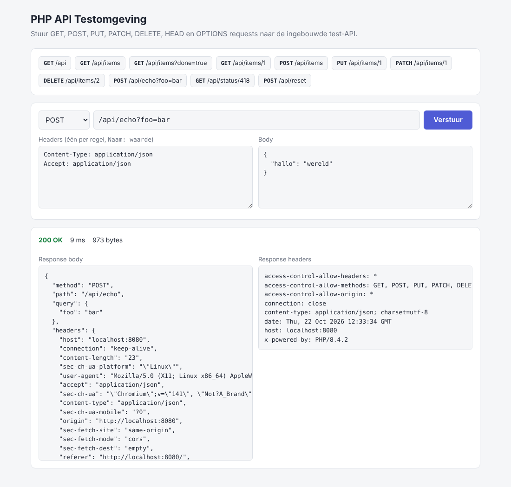

# PHP API Testomgeving

Kleine proof-of-concept om HTTP-requests (GET, POST, PUT, PATCH, DELETE, HEAD, OPTIONS) te testen.
Gebouwd met **PHP 8.4.2**, zonder framework of dependencies.



## Starten

### Met Docker (aanbevolen, gebruikt exact PHP 8.4.2)

```bash
docker compose up --build
```

### Met lokale PHP 8.4

```bash
php -S localhost:8080 -t public public/index.php
```

Open daarna <http://localhost:8080>.

## Wat zit erin

- **Web-UI** (`/`): kies een methode, URL, headers en body, en bekijk status, responstijd, headers en body. Met snelknoppen voor alle routes.
- **Test-API** (`/api/...`):

| Methode | Route                | Omschrijving                                       |
|---------|----------------------|----------------------------------------------------|
| GET     | `/api`               | Overzicht van alle routes                          |
| ANY     | `/api/echo`          | Stuurt je request terug (method, headers, query, body) |
| GET     | `/api/items`         | Alle items (filter: `?done=true\|false`)           |
| POST    | `/api/items`         | Nieuw item aanmaken                                |
| GET     | `/api/items/{id}`    | Eén item ophalen                                   |
| PUT     | `/api/items/{id}`    | Item volledig vervangen                            |
| PATCH   | `/api/items/{id}`    | Item gedeeltelijk bijwerken                        |
| DELETE  | `/api/items/{id}`    | Item verwijderen                                   |
| ANY     | `/api/status/{code}` | Geeft de opgegeven HTTP-statuscode terug           |
| POST    | `/api/reset`         | Zet de testdata terug                              |

Bodies mogen JSON (`application/json`) of formulierdata (`application/x-www-form-urlencoded`) zijn.
Data wordt opgeslagen in `data/items.json`.

## Voorbeelden met curl

```bash
curl http://localhost:8080/api/items
curl -X POST -H 'Content-Type: application/json' -d '{"name":"Test","done":false}' http://localhost:8080/api/items
curl -X PATCH -H 'Content-Type: application/json' -d '{"done":true}' http://localhost:8080/api/items/3
curl -X DELETE http://localhost:8080/api/items/3
```

## Gebruikte PHP 8.4-features

- Property hooks (`Request::$body`)
- Asymmetric visibility (`public private(set)`)
- `array_find()` en `array_any()`
- `new Foo()->method()` zonder extra haakjes
